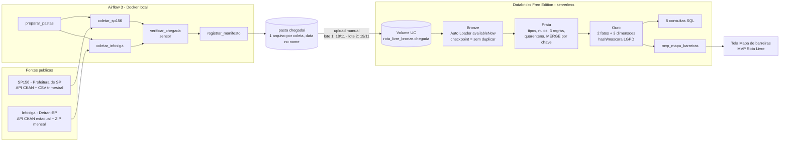

# Rota Livre - Big Data Architecture & Data Integration

> **Produto:** o Rota Livre mapeia barreiras de acessibilidade nas calcadas de Sao Paulo e aponta onde
> consertá-las protege mais pedestres.

Repositorio: https://github.com/Lucas-Gomes-Alcantara/rota-livre-bigdata

## Integrantes

| Nome completo | RM |
|---|---|
| Lucas Gomes Alcântara | RM98766 |
| Gabriel Gomes Catanzaro | RM93445 |
| Henrique Canali Cuzato | RM551326 |

## Perguntas que o MVP responde

1. Onde estao as barreiras de calcada registradas pelos cidadaos e quantas seguem sem solucao?
2. Quais tipos de barreira sao mais frequentes e quais demoram mais para ser resolvidos, em cada regiao?
3. Em quais areas da cidade barreiras nao resolvidas e atropelamentos de pedestres se sobrepoem (prioridade)?

## Arquitetura



O Databricks Free Edition nao se conecta ao Airflow: os arquivos de `chegada/` sao enviados manualmente ao Volume,
um lote por dia, como pede o enunciado.

## Fontes

| Fonte | Origem | Formato | Frequencia | Acesso automatizado | Recorte usado |
|---|---|---|---|---|---|
| SP156 - Solicitacoes | Prefeitura de SP / SMIT - `dados.prefeitura.sp.gov.br/dataset/dados-do-sp156` | CSV por trimestre (latin-1, `;`), licenca CC0 | trimestral | API CKAN `package_show` lista os recursos | 4 trimestres mais recentes (2025-T4 a 2026-T3), servicos ligados a calcada |
| Infosiga - Sinistros | Detran-SP - `dadosabertos.sp.gov.br/dataset/sinistros-infosiga` | ZIP com CSVs (latin-1, `;`, decimal com virgula), CC-BY 4.0 | mensal (~dia 15) | URL do ZIP descoberta pela API CKAN estadual | atropelamentos de pedestres no municipio de SP, 2022+ |

Limitacoes encontradas (detalhes em `docs/evidencias.md`):
- O link antigo do Infosiga passou a devolver HTML apos o portal novo de 2026; a coleta descobre o link atual pela API.
- O SP156 nao tem numero de protocolo -> chave substituta (hash + ordinal).
- O arquivo SP156 2026-T3 traz datas em `MM/dd/yyyy`; os demais em `dd/MM/yyyy` -> deteccao por arquivo.
- O servico "Guias, sarjetas e sarjetoes" deixou de existir no SP156 em 2026-T3.
- 36% dos sinistros de 2025-2026 na capital estao sem coordenada.
- Os dados de entrada sao reais; nenhum dado simulado foi usado.

## Estrutura do repositorio

```
rota-livre-bigdata/
├── airflow/               docker-compose (Airflow 3.3.1 + Postgres), variables.json, .env.example
├── dags/
│   ├── rota_livre_coleta.py   DAG agendado (07:00), 2 coletas paralelas + sensor + manifesto
│   └── coleta/                sp156.py, infosiga.py, comum.py (so biblioteca padrao)
├── chegada/               saida do DAG (fora do git; _manifesto/coletas.csv registra cada coleta)
├── databricks/
│   ├── 00_setup.sql           schemas e Volumes
│   ├── bronze/01_bronze_autoloader.py
│   ├── prata/02_prata.py
│   ├── ouro/03_ouro.py
│   └── consultas/04_consultas.sql
├── scripts/               00_verificar_fontes.py (checagem das fontes), gabarito_prata.py (teste independente)
├── amostras/              50 linhas reais de cada fonte
├── docs/                  evidencias.md, consultas.md, relatorio.md, prints/, verificacao/
├── README.md
└── requirements.txt
```

## Como reproduzir

**Pre-requisitos:** Docker Desktop (4 GB+ de RAM para o Docker), Python 3.10+ (so para o script de verificacao),
conta no Databricks Free Edition.

### 0. Verificar as fontes (opcional, recomendado)
```powershell
python scripts\00_verificar_fontes.py
```
Gera `docs/verificacao/` com recursos, cabecalhos reais e servicos candidatos.

### 1. Airflow (coleta)
```powershell
cd airflow
copy .env.example .env
# edite .env: gere AIRFLOW_FERNET_KEY e AIRFLOW_JWT_SECRET (comandos no proprio arquivo)
docker compose up airflow-init      # deve terminar com "10 of 10 variables successfully updated" e "INIT OK"
docker compose up -d
```
Abra http://localhost:8080, ative o DAG `rota_livre_coleta` e clique em **Trigger** (ou aguarde as 07:00).
Saida: `chegada/sp156_calcadas_AAAA-MM-DD.csv` e `chegada/infosiga_atropelamentos_sp_AAAA-MM-DD.csv`.
Toda configuracao fica em **Admin > Variables** (`rota_livre_*`); credencial opcional da API em `rota_livre_ckan_api_key`.

### 2. Databricks
1. Importe os notebooks de `databricks/` (Workspace > Import) e rode `00_setup.sql` uma vez.
2. **Lote 1:** envie os 2 CSVs do dia ao Volume `workspace.rota_livre_bronze.chegada` (Catalog > Upload to this volume).
3. Rode `01_bronze_autoloader` -> rode de novo (deve inserir 0 linhas) -> rode `02_prata`.
4. **Lote 2 (outro dia):** apos nova coleta, envie so os arquivos novos, rode `01_bronze_autoloader` e `02_prata`.
5. Salt do hash da Ouro (nunca no codigo), em uma das opcoes: secret `rota_livre/salt_hash`, widget `salt_hash`
   ou arquivo `/Volumes/workspace/rota_livre_bronze/sistema/segredos/salt_hash.txt`.
   Gere com `python -c "import secrets;print(secrets.token_urlsafe(32))"`.
6. Rode `03_ouro` e depois `04_consultas.sql`.

### 3. Conferir (teste independente da Prata)
```powershell
python scripts\gabarito_prata.py chegada\sp156_calcadas_AAAA-MM-DD.csv chegada\infosiga_atropelamentos_sp_AAAA-MM-DD.csv
```
Reaplica as regras em Python puro; os numeros devem bater com `rota_livre_prata.log_qualidade`.

## Camadas

| Camada | Tabelas | Destaques |
|---|---|---|
| Bronze | `sp156_solicitacoes`, `infosiga_sinistros`, `log_ingestao` | Auto Loader `availableNow`, tudo string, `_arquivo_origem`, `_lote`, `_data_ingestao`; checkpoint impede releitura |
| Prata | `sp156_barreiras`, `infosiga_atropelamentos`, `*_rejeitados`, `log_qualidade`, `log_merge`, `ref_categoria_barreira` | tipos, nulos, 3 regras (R1 coordenada, R2 data, R3 dominio) com contagem por regra, MERGE por chave com hash de conteudo |
| Ouro | `fato_ocorrencias`, `fato_sinistros_pedestres`, `dim_tempo`, `dim_localizacao`, `dim_categoria`, `mvp_mapa_barreiras` | celulas H3 res. 8; CEP em SHA-256 com salt, numero mascarado, coordenada com 3 casas |

## Protecao de dados e MVP

O SP156 publica logradouro + numero + CEP de cada pedido, o que pode identificar a residencia de quem reclamou.
Na Ouro: `cep_hash` (SHA-256 + salt secreto), `numero_mascarado` (`1243` -> `12XX`), coordenadas com 3 casas
(~110 m). O endereco exato fica so na Prata.

**Tabela consumida pelo MVP:** `workspace.rota_livre_ouro.mvp_mapa_barreiras` -> **tela "Mapa de barreiras"**.

| Campo | Elemento da tela |
|---|---|
| `geojson_celula` / `latitude_centro`, `longitude_centro` | hexagono (ou marcador) no mapa |
| `classe_prioridade` | cor: CRITICA vermelho, ALTA laranja, MEDIA amarelo, BAIXA verde, SEM_CRUZAMENTO cinza |
| `subprefeitura`, `distrito` | titulo do painel da area |
| `barreiras_abertas`, `barreiras_total`, `problema_mais_frequente` | cartao "Barreiras" |
| `media_dias_resolucao` | "tempo medio de resolucao na area" |
| `atropelamentos`, `vitimas_fatais`, `vitimas_graves` | cartao "Seguranca do pedestre" |
| `ranking_prioridade` | lista "Areas prioritarias" |

## Principais resultados

- 2 lotes coletados (18/11 e 19/11/2026); Bronze 630.310 + 61.176 linhas; reexecucao e lote repetido sem duplicar.
- Prata: 37.836 barreiras validas e 26.172 atropelamentos validos; barrados por regra em `docs/evidencias.md`.
- **Impacto:** 50 areas (2,4% da cidade) concentram 12,2% dos atropelamentos de pedestres, 11,5% das vitimas
  fatais e 13,3% das barreiras ainda abertas. Interpretacao e limites em `docs/consultas.md`.

## Checklist dos requisitos

Ver `docs/relatorio.md`, secao 5.
